# ElectroCasa Lakehouse

Proyecto integrador del curso de Azure Databricks. Pipeline de punta a punta para ElectroCasa (cadena de electrodomésticos con 40 sucursales): ingesta de las seis fuentes, modelo Medallion con Lakeflow Declarative Pipelines, orquestación con un job, despliegue con bundle y gobierno con Unity Catalog.

## Arquitectura

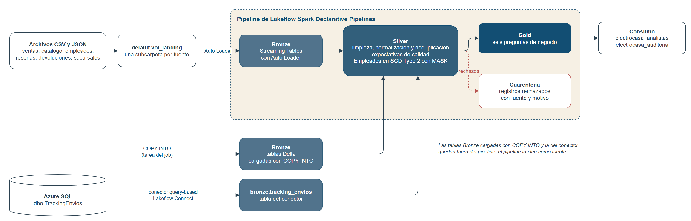

- **Bronze:** datos tal como llegan (todo como texto) + columnas de auditoría (`_ingesta_ts`, `_archivo_origen`, `_lote`).
- **Silver:** limpieza, estandarización, deduplicación y reglas de calidad. Los rechazados van a `silver.cuarentena`.
- **Gold:** una tabla por pregunta de negocio.

| Pregunta | Tabla Gold |
|---|---|
| 1. Ventas netas por sucursal y mes | `gold.ventas_netas_sucursal_mes` |
| 2. Top 10 productos (unidades y tasa de devolución) | `gold.top10_productos_unidades`, `gold.top10_productos_tasa_devolucion` |
| 3. Dotación por sucursal y mes | `gold.dotacion_sucursal_mes` |
| 4. Ventas por vendedor | `gold.ventas_vendedor_sucursal_mes` |
| 5. Reseñas negativas por categoría | `gold.resenas_negativas_categoria_mes` |
| 6. Despachos por courier | `gold.despachos_courier` |

## Ingesta

| Fuente | Método | Motivo |
|---|---|---|
| Ventas, empleados, reseñas, devoluciones | Auto Loader | Llegan por lotes, solo hay que procesar los archivos nuevos |
| Catálogo | COPY INTO | Snapshot completo, llega pocas veces |
| Sucursales | COPY INTO | Archivo de referencia pequeño |
| Tracking | Conector query-based de Lakeflow Connect | Cursor `fecha_modificacion`, llave `evento_id`, SCD Type 1 |

Tracking usa SCD Type 1 porque cada evento tiene un `evento_id` único y no cambia, entonces el merge por llave evita duplicados si se vuelve a leer algo. La contraseña está guardada en la Connection de Unity Catalog.

## Decisiones

- **Productos que no existen en el catálogo:** las ventas y reseñas se mantienen (con advertencia). En la pregunta 5 no entran porque no tienen categoría.
- **Devoluciones sin venta de origen:** se descartan, porque no se puede validar el monto.
- **Mismo DNI en dos empleados:** se dejan los dos y se marcan.
- **Salarios fuera de rango:** quedan en NULL y se usa el último salario válido.
- **Productos descontinuados:** se mantienen con `activo = false`.
- **Máscaras:** DNI muestra solo los últimos 3 dígitos; salario sale NULL. Solo `electrocasa_ingenieria` ve el valor real.

### Políticas de las reglas de calidad

| Fuente | Regla | Política | Motivo |
|---|---|---|---|
| Ventas | monto > 0, cantidad > 0, sucursal y fecha informadas | drop | Afectan directamente las ventas y el ticket |
| Catálogo | precio válido | warn | El precio no se usa en las preguntas y el producto se necesita para la categoría |
| Empleados | id y fecha del evento no nulos | drop | Sin eso no se puede ubicar el evento en la historia |
| Reseñas | calificación entre 1 y 5 | drop | La pregunta 5 pide excluirlas |
| Devoluciones | reembolso entre 0 y el monto de la venta | drop | Alteraría las ventas netas |
| Tracking | estado dentro de los 4 valores | drop | No sirve para la pregunta 6 |

No usé `fail` porque detendría todo el pipeline por pocas filas. Los rechazados se pueden consultar en `silver.cuarentena` con la fuente, la regla y el lote.

### Empleados (SCD Type 2)

Lo armé con funciones de ventana: cada evento es una versión, ordenada por `fecha_evento` y, si hay dos el mismo día, por `fecha_registro`. La versión vale desde su `fecha_evento` hasta la del siguiente evento. Como la tabla se recalcula con todos los eventos, los que llegan tarde en el lote 3 quedan en su lugar.

## Conteos por lote

| Tabla | Lote 1 | Lote 2 | Lote 3 |
|---|---:|---:|---:|
| bronze.ventas | 6.783 | 13.622 | 18.240 |
| bronze.empleados | 2.257 | 3.524 | 4.448 |
| bronze.resenas | 5.292 | 9.280 | 9.280 |
| bronze.devoluciones | 1.387 | 3.091 | 4.217 |
| bronze.catalogo | 2.305 | 4.705 | 4.705 |
| silver.ventas | 6.604 | 13.118 | 17.488 |
| silver.empleados_eventos | 2.239 | 3.495 | 4.410 |
| silver.resenas | 5.226 | 9.097 | 9.097 |
| silver.devoluciones | 1.301 | 2.877 | 3.908 |
| silver.catalogo | 2.280 | 2.400 | 2.400 |

Rechazados al final: ventas 512, devoluciones 249, reseñas 103, empleados 38.

Las ventas repetidas entre lotes no se duplican: Bronze tiene 18.240 filas pero solo 18.000 ventas distintas.

Lote 1:

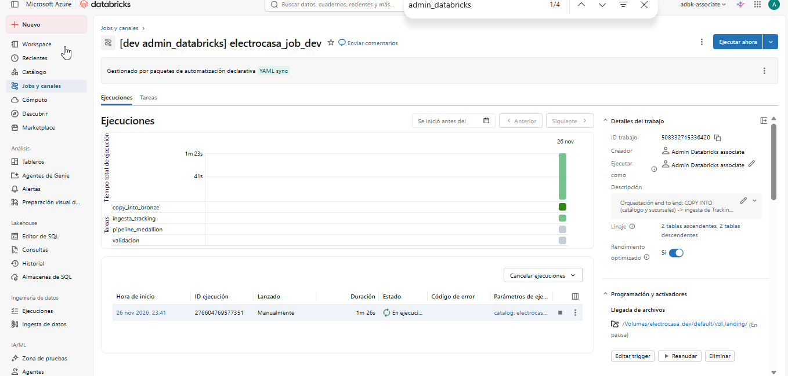

Carga de los lotes 2 y 3 al volume:

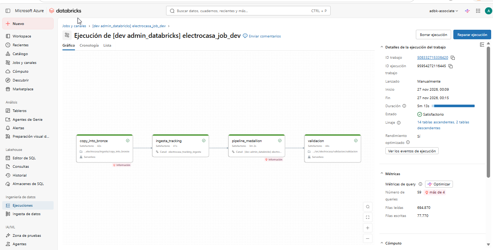
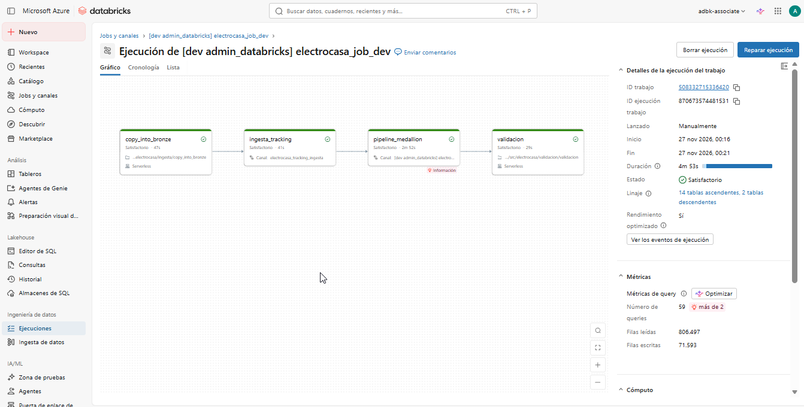

Lote 3 (final):

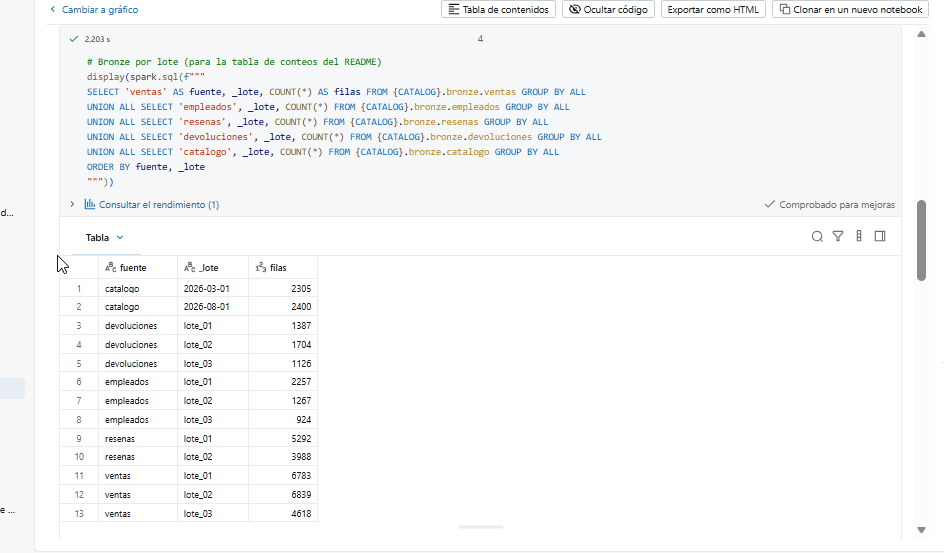
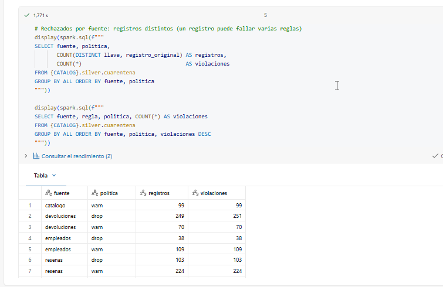
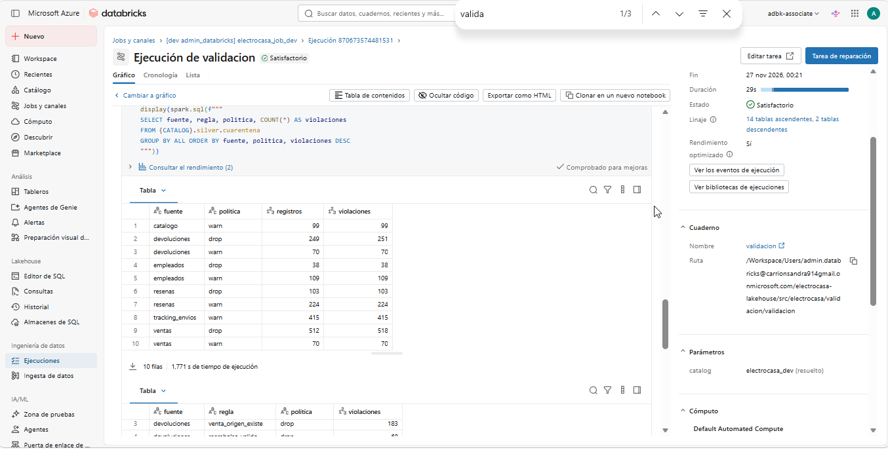

## Tracking: dos corridas del conector

La primera corrida hizo un MERGE con 15.139 filas. Las corridas siguientes no agregaron versiones nuevas porque no había cambios en la fuente.

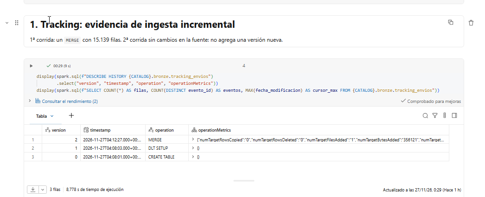

## Job

Orden: `copy_into_bronze` → `ingesta_tracking` → `pipeline_medallion` → `validacion`.

- **Trigger:** por llegada de archivo al volume, porque los lotes llegan en fechas irregulares.
- **Reintentos:** 2 en las ingestas y 1 en el pipeline.
- **Alertas:** por correo.
- **Validación:** muestra los conteos y los rechazados, y falla si alguna tabla Gold queda vacía.

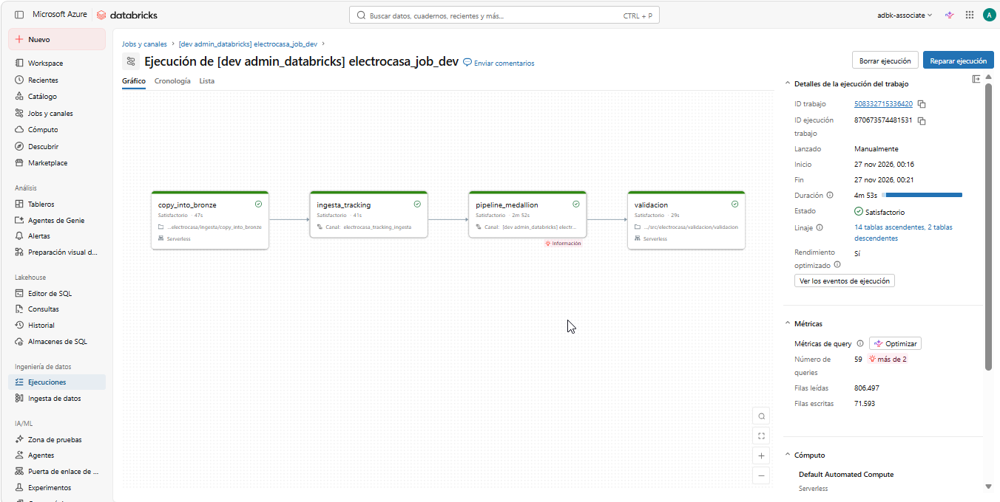

## Bundle

Targets `dev` (`electrocasa_dev`) y `prod` (`electrocasa_prod`). El despliegue se hizo desde el Git Folder.

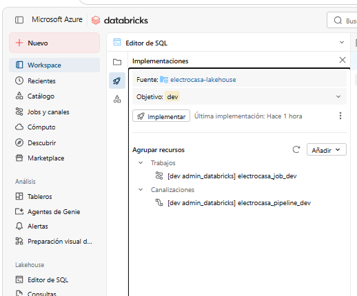
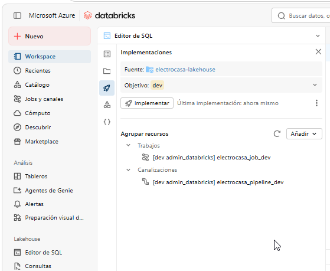

## Monitoreo y compute

- **Monitoreo:** con el event log del pipeline. La consulta a `system.lakeflow` no devolvió filas todavía (las tablas de sistema se actualizan con retraso), así que también usé el historial de corridas del job.
- **Compute:** todo es serverless. El pipeline corre en modo triggered porque los lotes son chicos y esporádicos.

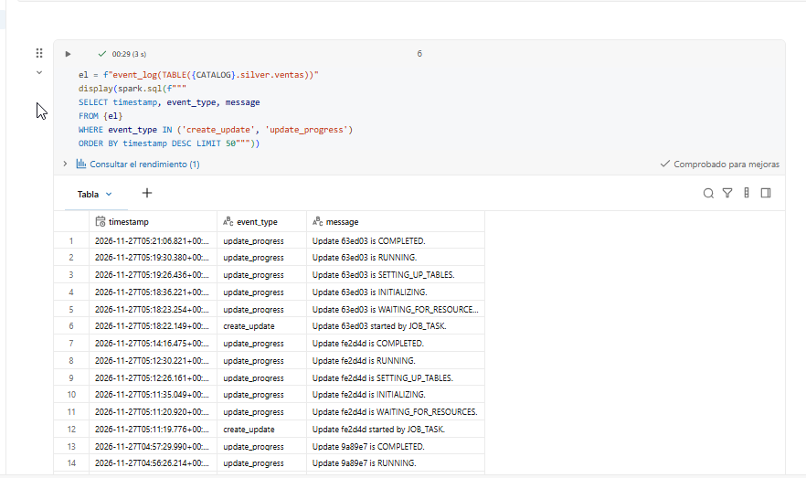

## Gobierno

| Grupo | Acceso |
|---|---|
| `electrocasa_ingenieria` | lectura y escritura en bronze, silver y gold |
| `electrocasa_analistas` | solo lectura en gold |
| `electrocasa_auditoria` | lectura en gold + auditoría y lineage |

### Demostración de REVOKE

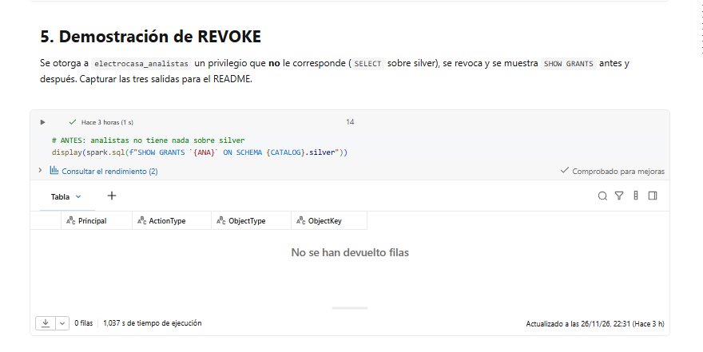
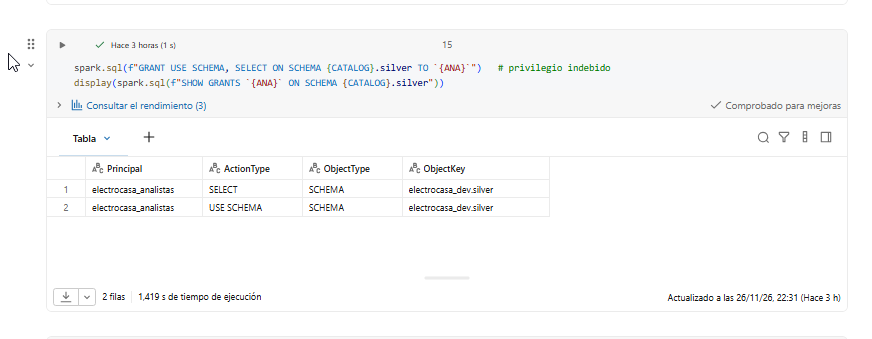
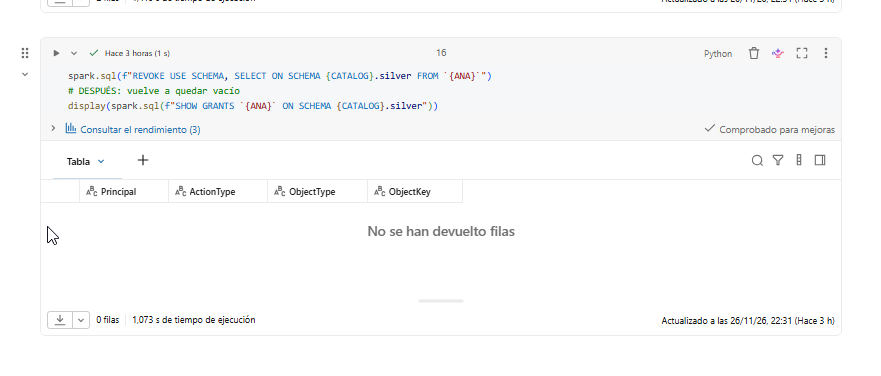

### Auditoría

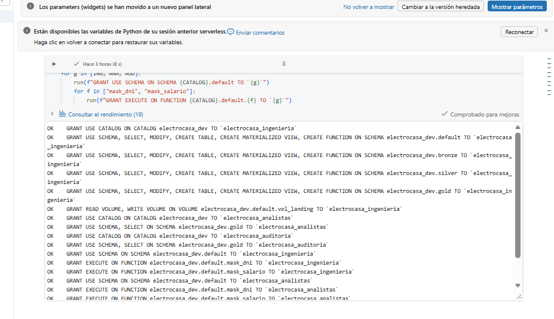
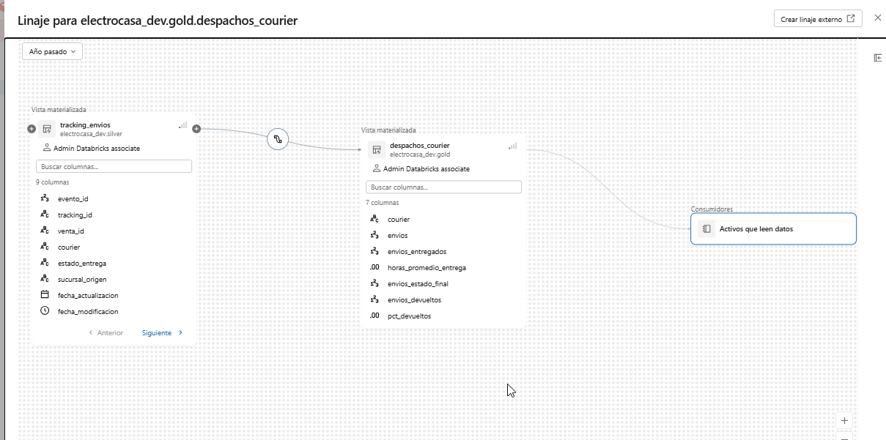

### Masking

Las máscaras están declaradas en el schema de las tablas del pipeline. Como el dueño del pipeline está en `electrocasa_ingenieria`, la tabla derivada `gold.empleados_actuales` guarda los valores reales y la máscara decide qué ve cada usuario.

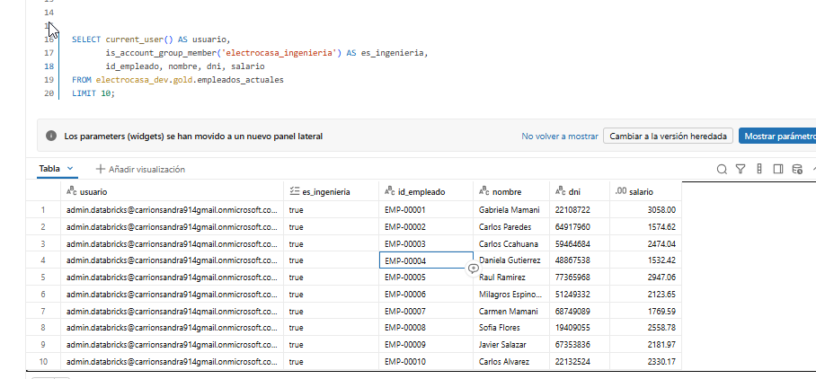

## Cómo desplegar

1. Crear los 3 grupos y agregarse a `electrocasa_ingenieria`.
2. Correr `notebooks/00_setup.ipynb`.
3. Crear la Connection de SQL Server y la ingesta de tracking, y poner su ID en `databricks.yml`.
4. Desplegar el bundle (target `dev`).
5. Cargar cada lote con `notebooks/02_carga_lotes` y correr el job.
